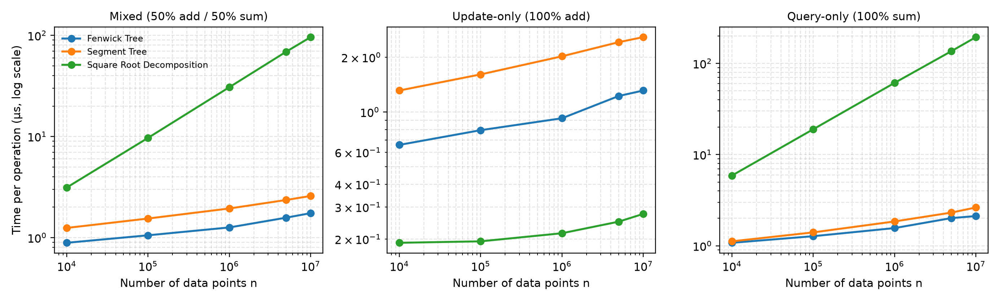

# COSC 520 Assignment 2: Dynamic Range-Sum Data Structures

This project implements and benchmarks three data structures that solve the same problem: keeping an integer array that changes over time while still answering range-sum queries quickly.

| Structure | Idea |
|---|---|
| **Fenwick Tree** (Binary Indexed Tree) | Each cell stores the sum of a power-of-two-sized block. Prefix sums are found by stripping the lowest set bit of the index. |
| **Segment Tree** (iterative, bottom-up) | A complete binary tree in which every internal node stores the sum of its two children. |
| **Square Root Decomposition** | The array is split into about √n blocks, and the sum of each block is cached. |

All three implement the same interface ([`RangeSumStructure`](src/advanced_structures/base.py)):

- `add(index, delta)`: add `delta` to one element (zero-based index).
- `range_sum(left, right)`: return the sum of the elements from `left` to `right`, both ends included.

Because the interface is shared, every structure gets the same input data and the same sequence of operations, so the comparison is fair. All structures are written from scratch. They use only Python's built-in `array` module to store numbers compactly, and no library implementation of these data structures is called.

- **Repository:** <https://github.com/humb1e1989/COSC520_Assignment2>
- **Dataset (10,000,000 integers, 80 MB):** [`data/values_10000000.bin`](https://github.com/humb1e1989/COSC520_Assignment2/raw/main/data/values_10000000.bin). It can also be regenerated locally; see [Dataset](#dataset).

---

## Complexity

`n` is the number of stored values. `b = ⌈√n⌉` is the block size used by Square Root Decomposition.

| Structure | Build | `add` | `range_sum` | Space (numbers stored) |
|---|---|---|---|---|
| Fenwick Tree | O(n) | O(log n) | O(log n) | n + 1 |
| Segment Tree | O(n) | O(log n) | O(log n) | 2n |
| Square Root Decomposition | O(n) | O(1) | O(n/b + b) = O(√n) | n + ⌈n/b⌉ |

Every value is a signed 64-bit integer, so storage in bytes is the count above × 8. The unit tests check these storage counts.

---

## Requirements

- Python **3.10 or later** (the code uses `X | Y` type hints).
- `matplotlib` for the plotting script only. The data structures, benchmark, and tests use only the standard library.

## Setup

macOS / Linux:

```bash
git clone https://github.com/humb1e1989/COSC520_Assignment2.git
cd COSC520_Assignment2
python3 -m venv .venv
source .venv/bin/activate
python -m pip install -e .
```

Windows (PowerShell):

```powershell
git clone https://github.com/humb1e1989/COSC520_Assignment2.git
cd COSC520_Assignment2
py -m venv .venv
.venv\Scripts\Activate.ps1
python -m pip install -e .
```

If PowerShell refuses to run `Activate.ps1`, run `Set-ExecutionPolicy -Scope CurrentUser RemoteSigned` once, or use `.venv\Scripts\activate.bat` in Command Prompt.

> **Multi-line commands.** The examples below use `\` to continue a line, which works in bash and zsh. In Windows PowerShell, replace each trailing `\` with a backtick `` ` ``, or put the whole command on one line.

`pip install -e .` installs the `advanced_structures` package from `src/` in editable mode, so the `python -m advanced_structures.<module>` commands below work from the project folder.

---

## Quick start

### 1. Run the unit tests

```bash
python -m unittest discover -s tests -v
```

The 16 tests check:

- hand-computed sums before and after an update;
- randomized `add` and `range_sum` operations compared against a plain Python list, for sizes 1, 2, 3, 15, 16, 17, 99, 100, 101 and 257 (around powers of two and perfect squares);
- invalid indices and reversed ranges raising errors;
- empty and single-element inputs;
- storage formulas;
- reproducible dataset and workload generation;
- the benchmark helpers (checksum, workload rows, argument parsing).

### 2. Run the demonstration

```bash
python -m advanced_structures.demo
```

Expected output:

```text
Initial values: [4, -2, 7, 3, 1, 8]
Fenwick Tree                 sum[1,4]= 9; after add(2,+5)=14
Segment Tree                 sum[1,4]= 9; after add(2,+5)=14
Square Root Decomposition    sum[1,4]= 9; after add(2,+5)=14
```

### 3. Run a quick benchmark (a few seconds)

```bash
python -m advanced_structures.benchmark \
  --generate \
  --sizes 1000,10000,100000 \
  --operations 500 \
  --repetitions 2 \
  --dataset data/smoke.bin \
  --output results/smoke.csv
```

---

## Dataset

The dataset is a file of **10,000,000 pseudorandom integers**:

| Property | Value |
|---|---|
| File | `data/values_10000000.bin` |
| Format | raw signed 64-bit little-endian integers (Python `array('q')`), no header |
| Value range | −1,000 to 1,000, inclusive |
| Generator | `random.Random(520).randint(-1000, 1000)` |
| Size | 80,000,000 bytes |
| SHA-256 | `5569c493c1262c42cd55f582e3d72d893cdfc76282f614155e8bb6fdbc1169d8` |

A benchmark of size `n` uses the first `n` values of the file.

**Option A: download.** The file is included in this repository. A direct download link is in the header of this README.

**Option B: regenerate it.** The generator is deterministic, so this command produces a byte-identical file on macOS, Linux, and Windows. It takes about 10 seconds. The command is on one line so that it works in every shell:

```bash
python -m advanced_structures.benchmark --generate --sizes 10000000 --operations 0 --repetitions 1 --workloads mixed --dataset data/values_10000000.bin --output results/dataset_check.csv
```

Then check that the file matches the SHA-256 checksum in the table above:

```bash
shasum -a 256 data/values_10000000.bin                         # macOS
sha256sum data/values_10000000.bin                             # Linux
Get-FileHash data\values_10000000.bin -Algorithm SHA256        # Windows PowerShell
certutil -hashfile data\values_10000000.bin SHA256             # Windows Command Prompt
```

The file is identical on every platform for three reasons:

- `random.Random(seed)` is Python's own Mersenne Twister. It produces the same sequence on every operating system.
- `array('q')` is always 8 bytes per value.
- The code writes and reads the file explicitly in little-endian byte order, whatever the native byte order of the machine is ([`dataset.py`](src/advanced_structures/dataset.py)).

**Why binary rather than CSV or Excel?**

- **Faster to load.** The binary file loads in about 0.05 s, compared with about 0.9 s for the same data as CSV. That is roughly 19× faster, because no text has to be parsed.
- **Exact type.** It stores the same 64-bit integer type that the data structures use.
- **Easy prefixes.** The first `n` values can be read directly.
- **Excel cannot hold it.** An Excel worksheet is limited to 1,048,576 rows.

See [DATASET_README.md](DATASET_README.md) for the full dataset record.

---

## Running the full experiment

```bash
python -m advanced_structures.benchmark \
  --sizes 10000,100000,1000000,5000000,10000000 \
  --operations 5000 \
  --repetitions 5 \
  --dataset data/values_10000000.bin \
  --output results/benchmark_full.csv
```

This took about 1.5 minutes on the machine described in [Test environment](#test-environment). Add `--generate` if the dataset file does not exist yet.

### Workload profiles

Each input size is measured under three workloads:

| Profile | `add` | `range_sum` | What it shows |
|---|---:|---:|---|
| `mixed` | 50% | 50% | a balanced, realistic use case |
| `update` | 100% | 0% | the cost of `add` alone |
| `query` | 0% | 100% | the cost of `range_sum` alone |

Update positions are chosen uniformly at random. For each query, the left end is uniform in `[0, n)` and the right end is uniform in `[left, n)`.

### Benchmark options

| Option | Default | Meaning |
|---|---|---|
| `--dataset` | `data/values.bin` | binary dataset path |
| `--generate` | off | regenerate the dataset before benchmarking |
| `--sizes` | `1000,10000,100000,1000000` | comma-separated input sizes `n` |
| `--workloads` | `mixed,update,query` | comma-separated workload profiles |
| `--operations` | `2000` | operations per measured run |
| `--repetitions` | `5` | measured repetitions per size and workload |
| `--seed` | `520` | seed for the dataset and the workloads |
| `--output` | `results/benchmark.csv` | raw results CSV |

### How the measurements are kept fair

- Every structure is **rebuilt from the same initial values** before each workload and each repetition.
- All structures run the **same ordered list of operations** in every run.
- A **checksum** (the XOR of all query answers) must be identical for all three structures. If it differs, the benchmark stops with an error. This confirms the structures are correct at full scale.
- An **unreported warm-up** run happens before each size. `gc.collect()` runs before each build.
- Only the build and the operation loop are timed (`time.perf_counter`). Workload generation and file I/O are outside the timed regions.
- The raw CSV keeps every repetition. Summaries and plots use the **median**.

### Summarize and plot

```bash
python -m advanced_structures.summarize_results \
  --input results/benchmark_full.csv \
  --output results/benchmark_summary.csv

python -m advanced_structures.plot_results \
  --input results/benchmark_full.csv \
  --output-dir results/plots
```

| Output | Content |
|---|---|
| `results/benchmark_full.csv` | every measured run (225 rows) |
| `results/benchmark_summary.csv` | median per workload, structure and `n`, including µs per operation |
| `plots/build_time.png`, `build_time_log.png` | build time (linear y-axis and log-log) |
| `plots/storage.png` | principal numeric storage in MB |
| `plots/{mixed,update,query}_time.png` | total workload time, linear y-axis |
| `plots/{mixed,update,query}_time_log.png` | the same data on log-log axes |
| `plots/operation_comparison.png` | time per operation for all three workloads side by side (log-log) |

On a log-log plot, a cost that grows like `nᵏ` appears as a straight line with slope `k`. Build time has slope 1 (O(n)). Square Root Decomposition queries have slope ½ (O(√n)). Logarithmic costs look almost flat.

---

## Results summary (n = 10,000,000)

Median of 5 runs, 5,000 operations per run. The full table is in [`results/benchmark_summary.csv`](results/benchmark_summary.csv).

| Structure | Build (s) | `add` (µs/op) | `range_sum` (µs/op) | Mixed (µs/op) | Storage (MB) |
|---|---:|---:|---:|---:|---:|
| Fenwick Tree | 1.20 | 1.31 | **2.12** | **1.75** | 80.0 |
| Segment Tree | 1.26 | 2.58 | 2.63 | 2.58 | 160.0 |
| Square Root Decomposition | **0.67** | **0.28** | 194.00 | 96.10 | 80.0 |



How the measurements compare with the theory, as `n` grows 1000× (from 10⁴ to 10⁷):

| Observation | Measured | Expected | Matches theory? |
|---|---|---|---|
| Sqrt `range_sum` time | ×33 | √1000 ≈ ×31.6 → O(√n) | yes |
| Fenwick `range_sum` time | ×2.0 | log₂10⁷ / log₂10⁴ ≈ ×1.75 → O(log n) | yes |
| Build time, all three | ×≈950 | ×1000 → O(n) | yes |
| Sqrt `add` time | 0.19 → 0.28 µs | O(1), i.e. flat | almost |

The Sqrt `add` time grows a little even though it is O(1). The likely cause is CPU caching. At small `n` the arrays fit in the CPU cache. At 80 MB they do not, so each random access is more likely to miss the cache and wait for main memory.

---

## Project structure

```text
src/advanced_structures/
├── base.py                 # abstract RangeSumStructure interface + input validation
├── fenwick_tree.py         # Fenwick Tree (Binary Indexed Tree)
├── segment_tree.py         # iterative bottom-up Segment Tree
├── sqrt_decomposition.py   # Square Root Decomposition
├── factory.py              # STRUCTURE_TYPES list and create_structure("fenwick" | "segment" | "sqrt")
├── dataset.py              # reproducible binary dataset generation / loading
├── workload.py             # reproducible mixed / update / query workloads
├── benchmark.py            # benchmark command-line program
├── summarize_results.py    # median summary table
├── plot_results.py         # report plots
└── demo.py                 # small demonstration
tests/
├── test_structures.py              # correctness of the three structures
└── test_dataset_and_workload.py    # dataset, workload, and benchmark helpers
data/                       # binary datasets
results/                    # raw CSV, summary CSV, plots
results/smoke*              # small sanity-check run only; not used in the report
DATASET_README.md           # dataset record (format, seed, checksum)
EXPERIMENT_PLAN.md          # experiment design and fairness controls
```

### Adding another structure

1. Subclass `RangeSumStructure` and implement `__init__`, `add`, `range_sum`, `__len__`, and `storage_bytes`.
2. Add the class to `STRUCTURE_TYPES` in [`factory.py`](src/advanced_structures/factory.py).

The benchmark, plots, and shared unit tests then include it automatically.

---

## Test environment

The results above were measured on:

| Component | Value |
|---|---|
| CPU | Apple M4 |
| Memory | 16 GB |
| OS | macOS 15.6.1 |
| Python | CPython 3.12.12 |
| matplotlib | 3.11.2 |

Timings differ on other machines. The relative ordering and growth rates should stay the same.

## License

[MIT](LICENSE)
